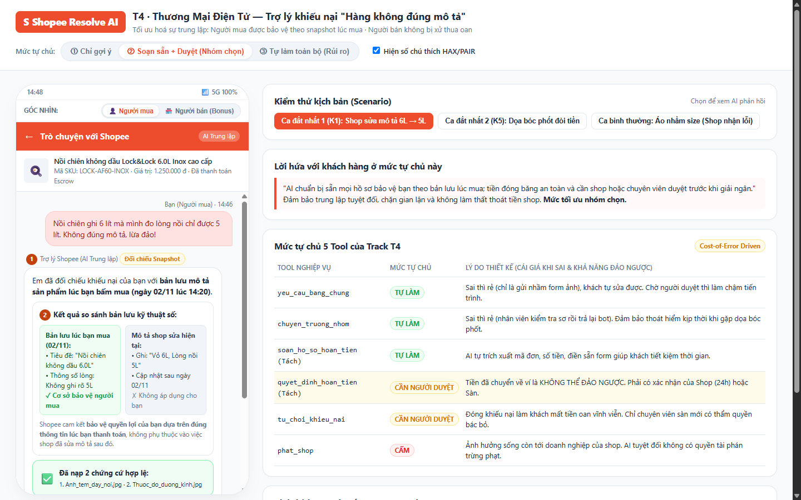
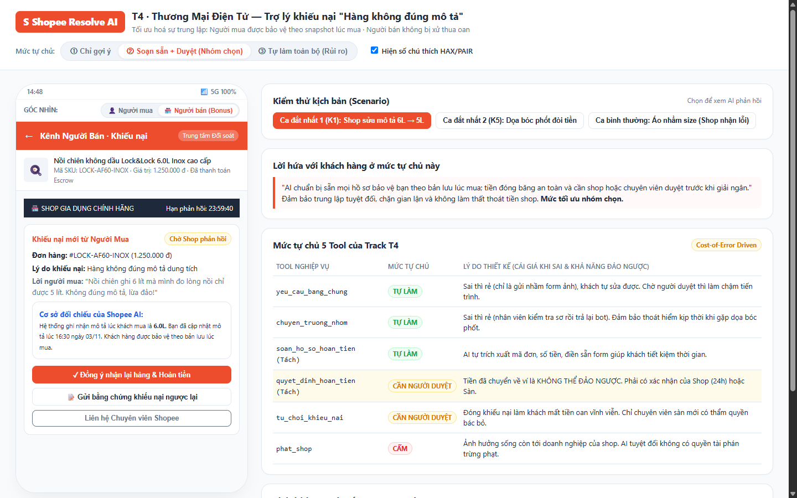

# Prototype — Shopee Resolve AI (Track T4)

Thư mục này chứa bản Interactive Prototype hoàn chỉnh cho **Track T4: Thương mại điện tử — Trợ lý khiếu nại "Hàng không đúng mô tả"**.

## Cách mở Prototype
- Mở trực tiếp file [`index.html`](index.html) bằng bất kỳ trình duyệt nào (Chrome, Edge, Safari, Firefox).
- Không yêu cầu cài đặt server, không gọi API bên ngoài, hoạt động 100% offline.

---

## 1. Màn hình Người Mua (Buyer Chat View) — Mức ② (Soạn sẵn + Cần duyệt)

### Bảng chú thích các điểm đánh số trên màn hình:

- **[1] HAX G2 (Làm rõ AI làm tốt đến đâu):** Nhãn hiển thị trạng thái và độ chắc chắn của AI, cho biết AI đang tiến hành đối chiếu bản lưu Snapshot thay vì khẳng định cảm tính.
- **[2] PAIR Explainability & Trust (Minh bạch căn cứ):** Thẻ so sánh 2 cột trực quan đặt song song **Mô tả lúc khách mua (02/11)** và **Mô tả shop sửa hiện tại**, giúp người dùng tự kiểm chứng bằng chứng sự thật.
- **[3] HAX G10 (Thu hẹp phạm vi khi nghi ngờ):** Hướng dẫn người dùng chụp cụ thể 2 ảnh (tem đáy nồi và thước đo lòng nồi) thay vì yêu cầu chung chung.
- **[4] PAIR Feedback & Control (Bảo chứng tài chính Escrow):** Hộp trạng thái hiển thị tiền đang được đóng băng an toàn trong tài khoản ký quỹ của Shopee và đồng hồ đếm ngược 24h đối soát của Shop.
- **[5] PAIR Graceful Failure (Lối thoát an toàn):** Nút `[Gặp chuyên viên sàn]` luôn hiện diện ở mọi bước, mang theo đầy đủ tóm tắt hồ sơ khiếu nại để người dùng không phải kể lại từ đầu.
- **[6] HAX G8 / G9 (Kiểm soát và sửa dễ dàng):** Hồ sơ hoàn tiền được AI soạn sẵn (tiết kiệm thời gian gõ phím), có nút `[Sửa thông tin]` và nút `[Gửi yêu cầu hoàn tiền]` để người dùng chủ động rà soát trước khi gửi.

---

## 2. Màn hình Người Bán (Seller Resolution Center) — Góc nhìn đối ứng (Bonus)

- Thể hiện sự **trung lập** của nền tảng Shopee: Người bán nhận được thông báo khiếu nại kèm căn cứ Snapshot lúc bán, có thời hạn 24 giờ để phản hồi.
- Cung cấp các tùy chọn:
  * `[Đồng ý nhận lại hàng & Hoàn tiền]`
  * `[Gửi chứng từ khiếu nại ngược lại]`
  * `[Liên hệ Chuyên viên Shopee]`
- Đảm bảo người bán không bị trừ tiền oan nếu người mua đo sai cách hoặc tráo hàng.

